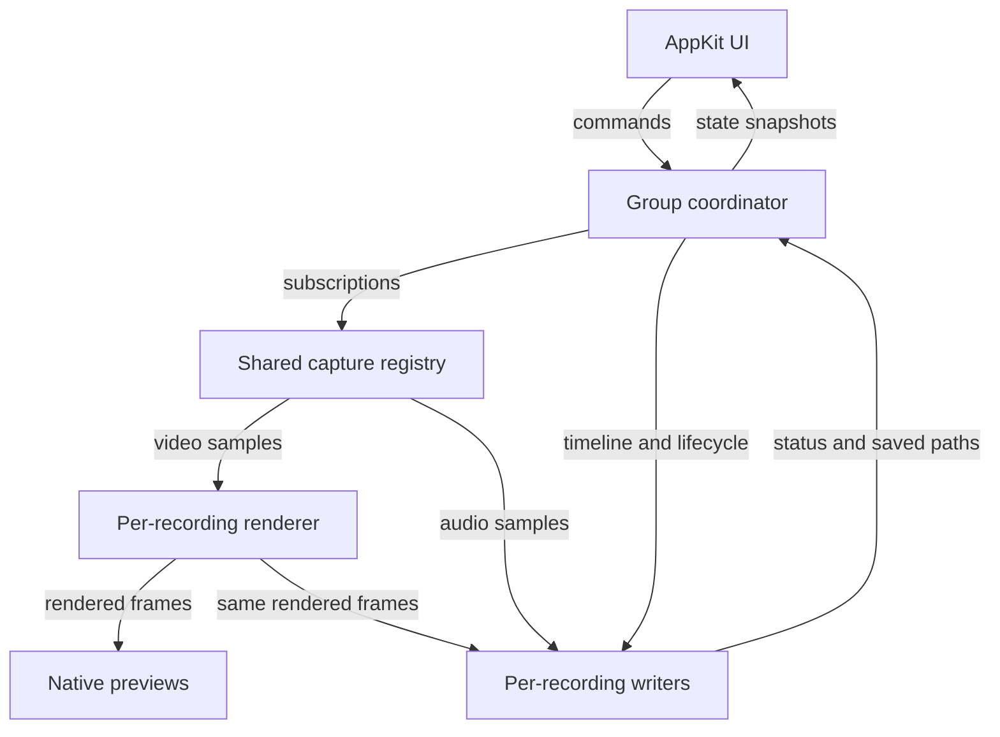

# Requirements

### Goal
Build Oculi as a responsive Rust application with a native macOS interface for simultaneously recording multiple video/audio pairs. Target **macOS 15 Sequoia or later**.

### Confirmed scope
- Each recording selects **one video source and one audio source**, with independent framing, output directory, and filename template.
- Video sources: cameras, displays, individual windows, and applications. Application video captures that app’s windows on a selected display; it is not a cross-display scene.
- Audio sources: microphones/audio input devices, application playback, or system playback. No audio mixing in this version. Application audio is app-wide, not isolated to an individual window, and is selected independently of video.
- Automatically discover sources and populate categorized dropdowns. Refresh changing sources without losing selections; visibly mark unavailable sources rather than silently substituting another.
- Add, duplicate, remove, and persist recording configurations. Revalidate permissions, devices, and destinations when restoring them.
- **Group-only Start / Pause / Resume / Stop & Save** controls operate on all configured recordings. Each recording produces its own video file with audio.
- Live previews before recording, during recording, and while paused. Pauses omit elapsed time from saved files without stopping previews.
- OBS-like **single-source framing**: drag to reposition, resize with handles, crop, zoom, fit/fill/reset, and numeric controls within a fixed output canvas. Framing can change live; preview and saved output use the same transform. Editor handles never appear in recordings.
- Native light/dark appearance, clear per-recording status, elapsed time, audio activity, permission guidance, and actionable errors.

### Output and lifecycle defaults
- MP4 with H.264 video and AAC audio; default 1080p/30 fps, with per-recording resolution/FPS settings validated before starting. SDR output only initially.
- Directory picker per recording and a template such as `{name}_{date}_{time}_{counter}.mp4`; use one group start timestamp, sanitize filenames, and never overwrite an existing file.
- Source, destination, and output-format settings are locked while a group is active; framing remains editable. Stop finishes every writer asynchronously and reports each saved path or failure.
- Preflight the whole group before starting. If a required source or writer fails during recording, stop the group and attempt to finalize all usable partial outputs; report failures explicitly.
- Simultaneous streams share a common logical start and pause timeline; this is not a promise of hardware-frame-exact synchronization across devices. Capacity depends on hardware and selected formats, with visible overload diagnostics.

### Out of scope
Multi-source scenes, overlays, transitions, audio mixing/monitoring, streaming, editing recorded clips, HDR, non-macOS platforms, and App Store distribution. Protected content cannot be bypassed, and macOS capture permission prompts remain under system control.

# Technical Design

### Existing project
`Cargo.toml` defines the Rust 2024 package `oculi` with no dependencies. `src/main.rs` only prints `Hello, world!`. There are no existing UI, capture, persistence, or testing patterns to extend; all paths below other than these two files are proposed additions.

### Architecture decisions
- **Native UI directly from Rust:** AppKit through `objc2`/`objc2-app-kit`, rather than a webview. Keep AppKit work on the main thread; isolate Apple framework ownership and unsafe calls in platform adapters.
- **Shared capture registry:** compatible subscriptions reuse capture sessions, including exclusive camera/microphone devices. Each recording retains its own transform, preview, writer, and output timeline. Share capture, not encoded output.
- **Apple media stack:** ScreenCaptureKit for screen/window/application video and playback audio; AVFoundation for camera/input-device capture and MP4 writing. GPU-backed Core Image/Metal rendering supplies both preview and encoding.
- **Asynchronous control:** a serialized coordinator receives commands and emits immutable UI snapshots. Dedicated capture/render/writer queues do not block AppKit or capture callbacks. Native sample buffers cross queues only through explicitly audited ownership/threading wrappers, never blanket unsafe `Send`/`Sync` implementations.



### Modules and contracts
- `src/main.rs`, `src/app.rs`, `src/lib.rs`: launch native application, wire services, and expose testable core logic.
- `src/model.rs`: `RecordingConfig`, typed video/audio source selectors, `ViewportTransform`, output settings, source availability, and group states.
- `src/ui/{mod,recording_list,source_picker,viewport,toolbar}.rs`: native split-view recording list and selected-recording editor, lightweight preview thumbnails, accessible controls, directory picker, status/errors, and group actions.
- `src/platform/macos/{mod,permissions,discovery,screen_capture,device_capture}.rs`: discovery, authorization, retained sample buffers, and framework delegates.
- `src/capture/{mod,registry}.rs`: source identity, reference-counted subscriptions, format compatibility, and bounded sample distribution.
- `src/render/{mod,transform,preview}.rs`: crop/scale/translation geometry, GPU rendering into pooled pixel buffers, and native preview presentation.
- `src/recording/{mod,coordinator,timeline,writer}.rs`: group lifecycle, shared clock mapping, pause handling, independent AVAssetWriter instances, and finalization.
- `src/storage/{mod,settings,naming}.rs`: versioned configuration persistence, output validation, filename reservation, and staging-file promotion.
- `resources/Info.plist`, `scripts/bundle.sh`: a reproducible local `.app` bundle with stable bundle identifier, camera/microphone usage descriptions, and macOS 15 minimum version. Release signing/notarization is deferred.

Representative contracts:
```rust
enum GroupCommand { Start, Pause, Resume, Stop }
enum GroupState { Idle, Preparing, Recording, Paused, Finalizing, Failed }

struct RecordingConfig {
    id: RecordingId,
    name: String,
    video: VideoSourceSelector,
    audio: AudioSourceSelector,
    viewport: ViewportTransform,
    output: OutputSettings,
}

// Lease release removes a subscriber; unused capture sessions stop.
fn subscribe(&mut self, request: CaptureRequest)
    -> Result<CaptureLease, CaptureError>;
```

### Discovery and capture behavior
Use `SCShareableContent` for displays/windows/apps and `AVCaptureDeviceDiscoverySession` for cameras and input devices. Combine device notifications with asynchronous, debounced shareable-content refresh. Persist device identifiers and application bundle identifiers; treat window IDs/PIDs as session-scoped and require reselection when a saved target cannot be identified reliably.

A window uses a desktop-independent `SCContentFilter`; an application uses an application-inclusive filter on the selected display. Audio uses an independently selected application/system filter, so camera video can pair with application audio and a window can pair with a microphone. Exclude Oculi’s own playback from system capture where supported; no audible monitoring by default. Validate audio routing behavior on macOS 15 rather than assuming a window filter provides window-specific audio.

Key capture sessions by source/filter and compatible media requirements. Resolve shared capture formats before group start, then scale/downsample per recording. Preview leases may remain active while writers are absent or paused. Hidden thumbnails are throttled, and released configurations relinquish their subscriptions. A failed shared source is reported to every dependent recording.

### Viewport and preview
Store normalized source crop plus canvas-space placement/scale. Convert AppKit coordinates and Retina backing scale explicitly; retain fixed output dimensions when source/window size changes. Apply crop, aspect-preserving scaling, translation, clipping, and black-background fill in one renderer. Present its clean output in a Metal-backed native view and draw editor handles separately. Send transform snapshots to the render queue at frame boundaries, so editing one recording cannot alter another sharing the same source.

### Timing, encoding, and failure handling
Preflight source permissions, selected formats, writable destinations, and filename reservations for all recordings. Prepare subscriptions and writers before committing a shared host-clock start boundary. Map ScreenCaptureKit and capture-device timestamps into that clock; monitor drift and normalize audio as necessary. Retimestamp audio and video with the same accumulated group-pause offset, trimming audio buffers at pause/resume boundaries. Do not independently zero each track or concatenate files after pausing.

Use `AVAssetWriter` inputs and a pixel-buffer adaptor for H.264/AAC output. Prefer hardware acceleration where available and report unsupported configurations. Sample static screen content at the requested output cadence using the last valid frame; explicitly detected source loss triggers failure rather than silently recording a stale picture indefinitely.

Preview buffers are latest-frame-only; writer queues are bounded. Never block a capture callback behind a slow preview or writer. Drop late video frames with correct timestamps and visible counters; do not silently discard overflowing audio—surface sustained overload and stop/finalize the group. On Stop, drain accepted samples, mark inputs finished, and await each writer before reporting success. Use uniquely reserved staging files in the destination and promote completed files without replacement; retain failed artifacts with an explicit incomplete status rather than promising crash recovery.

### Dependencies and persistence
Add compatible pinned `objc2` framework crates for AppKit/Foundation, ScreenCaptureKit, AVFoundation, CoreMedia/CoreVideo, CoreImage/Metal/QuartzCore, plus dispatch/block support as needed. Use `serde`/`serde_json`, structured error types, logging, and bounded channels for the Rust core. Store versioned settings atomically under Application Support/Oculi. No FFmpeg executable is required at runtime.

### Platform references
- [Apple ScreenCaptureKit overview](https://developer.apple.com/videos/play/wwdc2022/10156): window/application filtering and application-level audio.
- [Rust ScreenCaptureKit bindings](https://docs.rs/objc2-screen-capture-kit).
- [Rust AVFoundation bindings](https://docs.rs/objc2-av-foundation).

# Testing

### Automated core tests
- Configuration round trips/migrations, unavailable restored targets, naming substitutions, sanitization, collision prevention, and unwritable destinations.
- Group transitions, repeated controls, start rollback, stop while paused, failure fan-out, and finalization outcomes using fake capture and writer adapters.
- Shared-source reference counts, compatible format negotiation, slow-consumer isolation, and bounded queue behavior.
- Crop/placement geometry, Retina coordinate conversion, fit/fill/reset, source resizing, and independent transforms for recordings sharing a source.
- Synthetic audio/video clocks: common start, repeated pauses, boundary-crossing audio buffers, timestamp monotonicity, drift handling, and omitted pause intervals.

### macOS integration tests
Use generated frames and tones to record at least two MP4 files concurrently through the real renderer/writer. Inspect tracks, dimensions, monotonic timing, duration, and decoded crop landmarks using AVFoundation. Verify live transform changes affect only the intended output and that preview receives the same rendered frame geometry without editor overlays.

Provide permission-gated smoke tests for real camera, window, application, microphone, application-audio, and system-audio adapters. Check discovery changes, permission denial, source closure/disconnection, shared-source reuse, and shutdown with no remaining capture leases. Hardware/TCC tests run only where devices and permissions are available; report skipped checks rather than claiming them verified.

Run `cargo fmt --check`, `cargo clippy`, and `cargo test`; build and launch the `.app` on macOS 15+ when available. Collect queue depth, dropped frames, render latency, and writer failures during concurrent synthetic recording to validate bounded resource behavior.

# Delivery Steps

### ✓ Step 1: Build the native recording configuration interface
Oculi launches as a native macOS app with persistent recording configurations and discovered source dropdowns.
- Replace the hello-world entry point and extend `Cargo.toml` with the selected native framework and core dependencies.
- Implement `model`, `app`, `ui`, storage settings, and macOS permissions/discovery modules.
- Add recording creation/duplication/removal, categorized video/audio selectors, destination/template controls, and unavailable-source states.
- Add `.app` bundle metadata and packaging with a stable identity and macOS 15 minimum version.
- Test configuration persistence, discovery diffing, selection restoration, and filename validation.

### ✓ Step 2: Restructure the native configuration workspace
Prioritize UI structure before capture; existing saved configuration compatibility is not required.
- Show every configured video/audio recording pair as a central preview card with clearly labeled placeholders until live previews are implemented.
- Add a left source drawer with selection and add/edit buttons opening a source/audio configuration window; deletion requires confirmation.
- Add a bottom drawer for the selected recording's output settings and disabled group-wide Start / Pause / Stop & Save controls until recording is implemented.
- Move global settings into a separate window accessible from the application menu bar.
- Verify configuration dialogs, selection, deletion confirmation, output validation, and native layout with automated tests and the app smoke check.

### ✓ Step 3: Implement shared video and audio capture
Multiple recording configurations can consume shared native capture sources without blocking the interface.
- Implement ScreenCaptureKit window/display/application capture and independent application/system audio selection.
- Implement AVFoundation camera and audio-input capture adapters.
- Add `capture/registry.rs` with reference-counted leases, compatible format negotiation, bounded subscriptions, and explicit buffer ownership.
- Propagate permission changes, source loss, device contention, and stream errors to application state.
- Test shared-source reuse, teardown, slow subscribers, and permission-gated adapter capture.

### * Step 4: Add live previews and single-source viewport editing
Each recording previews its own editable crop and framing before and during capture.
- Implement GPU-backed rendering and native previews in `render` and `ui/viewport.rs`.
- Add drag/resize/crop/zoom, numeric placement, fit/fill/reset, and fixed-canvas output settings.
- Apply live transform snapshots per recording; keep selection overlays outside encoded frame surfaces.
- Throttle inactive previews and handle Retina coordinates and changing source dimensions.
- Test transform geometry, preview/output frame consistency, and independent framing of a shared source.

###   Step 5: Implement independent media files on a shared timeline
Each recording can write a correctly timed audio/video MP4 to its configured destination.
- Implement `recording/writer.rs` and `timeline.rs` using AVAssetWriter, pooled rendered buffers, AAC audio, and shared host-clock mapping.
- Support common start boundaries, pause-offset retiming, audio boundary trimming, static-frame cadence, and drift diagnostics.
- Reserve collision-safe filenames and finalize staging files without overwriting existing recordings.
- Enforce bounded writer queues and explicit overload/disk-write failure reporting.
- Validate concurrent synthetic recordings, decoded crop landmarks, audio/video timing, repeated pauses, and save failures.

###   Step 6: Connect group recording controls and robust lifecycle handling
Start, Pause, Resume, and Stop & Save reliably control every configured recording while previews remain responsive.
- Implement the serialized group coordinator with all-recording preflight, preparation rollback, common lifecycle boundaries, and asynchronous finalization.
- Wire group controls, elapsed time, audio activity, output paths, progress, and error states into the native interface.
- Lock source/output configuration during an active group while allowing viewport edits and paused previews.
- Stop the group on fatal source/writer errors, finalize usable outputs, and release resources correctly on completion or application exit.
- Exercise state-machine failure scenarios and end-to-end concurrent capture; run formatting, linting, automated tests, and available macOS bundle smoke checks.